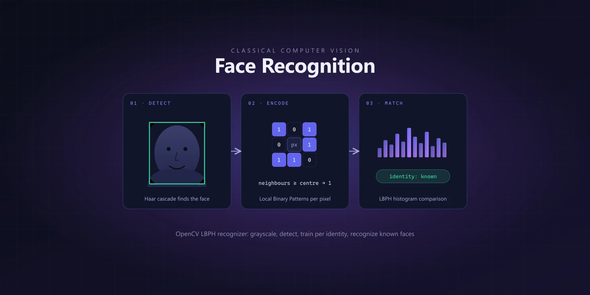
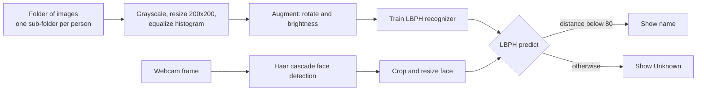

<div align="center">
  
  <p><code>Classical face recognition notebook: Haar cascade detection and an LBPH recognizer trained per identity</code></p>

  
  
  
  
  
  

  <a href="#-overview">Overview</a> · <a href="#-highlights">Highlights</a> · <a href="#-preview">Preview</a> · <a href="#-architecture">Architecture</a> · <a href="#-tech-stack">Tech Stack</a> · <a href="#-getting-started">Getting Started</a> · <a href="#-author">Author</a>
</div>


## ◈ Overview

A single notebook, `lbph_face_recognition.ipynb`, that trains an OpenCV Local Binary Patterns Histogram (LBPH) recognizer on a folder of face images and then runs it on a live webcam feed.

This is a **classical computer vision project, not deep learning**. There is no neural network: faces are found with a Haar cascade and identified by comparing local texture histograms. It is an academic exercise that shows what traditional methods can do.

**Privacy:** the face datasets used for training are personal and are not included in this repository. No face photos are shipped.


## ◈ Highlights

<table>
<tr>
<td width="33%" valign="top"><b>Haar cascade detection</b><br>Finds faces in webcam frames with <code>haarcascade_frontalface_default</code>.</td>
<td width="33%" valign="top"><b>LBPH recognizer</b><br>OpenCV <code>LBPHFaceRecognizer</code> trained with one label per identity.</td>
<td width="33%" valign="top"><b>Light preprocessing</b><br>Grayscale, 200x200 resize and histogram equalization.</td>
</tr>
<tr>
<td valign="top"><b>Simple augmentation</b><br>Two small rotations and two brightness shifts per image.</td>
<td valign="top"><b>Unknown handling</b><br>Predictions with an LBPH distance of 80 or more are labelled Unknown.</td>
<td valign="top"><b>Live loop</b><br>Draws a box and the name on each frame. Press <code>q</code> to quit.</td>
</tr>
</table>


## ◈ Preview

<div align="center">
  
</div>


## ◈ Architecture




## ◈ Tech Stack

| Layer | Technologies | Purpose |
|---|---|---|
| Language | Python | Notebook code |
| Vision | OpenCV (contrib build, for `cv2.face`) | Detection, LBPH training and prediction |
| Arrays | NumPy | Image and label arrays |
| Environment | Jupyter | Running the notebook |


## ◈ Getting Started

```bash
git clone https://github.com/Saji-d/face-recognition-system.git
cd face-recognition-system
pip install jupyter numpy opencv-contrib-python
jupyter notebook lbph_face_recognition.ipynb
```

1. Create a dataset folder with one sub-folder per person containing that person's face images (use your own and get consent).
2. Edit `dataset_path` in the first cell. It currently holds a Windows path from the author's machine.
3. Run the cells to train, then run the webcam cell. A camera is required.

The notebook trains on the images as given without detecting faces first, so the training images should already be tightly cropped faces.


## ◈ Roadmap

- [ ] Detect and crop faces during training as well as at inference
- [ ] Hold out a test set and report accuracy
- [ ] Move paths and thresholds into variables or arguments

Also part of the wider [computer-vision-and-pattern-recognition](https://github.com/Saji-d/computer-vision-and-pattern-recognition) collection.


## ◈ Author

**Sajidur Rahman Sajid** - Full-Stack Developer and AI engineer from Dhaka.

[Portfolio](https://www.sajidur.me) · [LinkedIn](https://www.linkedin.com/in/sajidur-rahman-sajid/) · [GitHub](https://github.com/Saji-d) · [Email](mailto:sajidsajidurrahman99@gmail.com)

<sub>Academic project. No datasets included.</sub>
